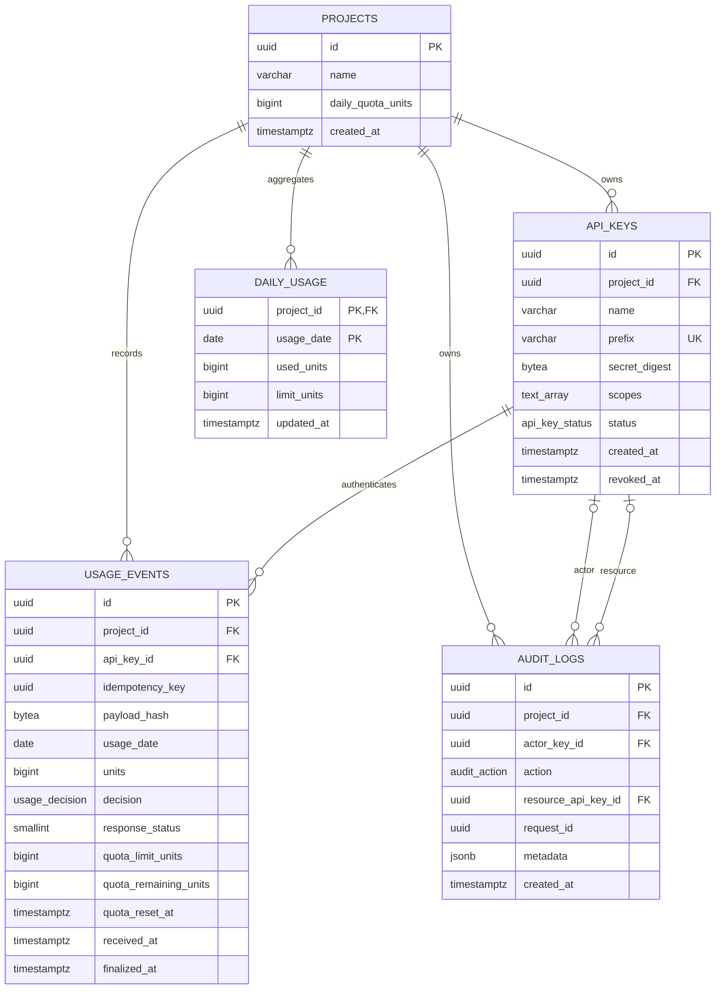

# ERD

모든 자식 관계는 `project_id`를 tenant 경계로 사용합니다. `usage_events`의 idempotency uniqueness는 단일 열이 아니라 `(project_id, idempotency_key)` 복합 제약입니다. Key를 참조하는 usage/audit FK도 `(project_id, api_key_id)` 복합 관계이므로 다른 Project의 Key 결합을 DB가 거부합니다. 전체 constraint·index는 [DB 명세](../specs/database-schema.md)에 있습니다.
